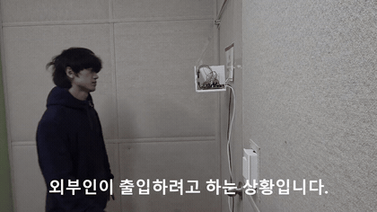
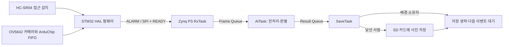

# 접근 이벤트 기반 사진 판별·선별 저장 시스템

[시연영상](media/demo.mp4) · [영상 구간 안내](docs/demo.md) · [시스템 구조](docs/architecture.md) · [개발 과정](docs/development.md) · [결과와 조건](docs/results.md) · [코드 지도](docs/code-map.md) · [재현 안내](docs/reproduction.md)

초음파 센서가 접근을 감지하면 **사진 한 장**을 촬영하고, Zynq에서 배경·소유자·낯선 사람을 판별해 낯선 사람으로 판단한 사진만 SD 카드에 저장하는 장치입니다. 센서 입력, 카메라 FIFO, 두 보드 사이의 SPI 전송, C 추론과 파일 저장을 하나의 이벤트 흐름으로 연결했습니다.

**임베디드시스템설계 프로젝트 3 · STM32F103RB · Zybo Z7-20 · C · STM32 HAL · FreeRTOS · SPI/I2C · DMA · FatFs**

## 장치에서 일어나는 일

STM32는 **HAL 기반 bare-metal 펌웨어**로 센서와 카메라를 제어합니다. Zynq는 기존 Xilinx BSP 위의 **FreeRTOS 애플리케이션**으로 수신·판별·저장을 처리합니다. CNN은 Zynq PS에서 float32 C 코드로 실행합니다.

## 주요 설계

| 문제 | 구현한 구조 | 읽어볼 코드 |
|---|---|---|
| STM32 내부 RAM보다 큰 사진 | 카메라 외부 FIFO에 보관하고 2,048바이트씩 전달 | [STM32 보고서 참조 코드](source/report-reference/stm32_main.c) |
| SPI master가 응답 준비 전에 읽을 가능성 | 1바이트 명령과 응답을 분리하고, DMA 등록 성공 뒤 READY 신호 제공 | [인터페이스 설명](docs/architecture.md#명령과-응답의-준비-조건) |
| 촬영·판별·저장의 실행 순서 | ISR→binary semaphore→RxTask→frame queue→AITask→result queue→SaveTask | [Zynq 보고서 참조 코드](source/report-reference/zynq_main.c) |
| 처리 도중 사진 버퍼가 덮어써질 가능성 | 단일 버퍼의 처리 중 새 접근 알림을 `gBusy`로 억제 | [데이터 전달과 버퍼 사용](docs/architecture.md#태스크와-버퍼-사용) |
| 모든 사진을 저장하는 비용 | 배경·소유자는 저장을 생략하고 낯선 사람만 원본 사진 저장 | [판별과 저장 조건](docs/architecture.md#판별과-저장) |

최종 보고서 부록의 전송 설정은 **320×240 RGB565 = 153,600바이트 = 2 KB × 75청크**입니다. 이 설정과 시연 로그의 중간 버전은 [코드 지도](docs/code-map.md)에서 구분했습니다.

## 동작 확인

시연영상과 보고서 로그에서 접근 인터럽트 뒤 수신·판별·저장을 거쳐 대기로 돌아가는 흐름을 확인할 수 있습니다. 소유자·배경은 저장을 생략하고 낯선 사람은 저장하는 사례가 제시됩니다.

- 보고서의 **93.33%**는 PC의 3클래스 모델 검증 60장에 대한 결과입니다. 보드에서 실행하는 최종 임베딩 기반 판별의 정확도와 구분합니다.
- 전력 수치는 데이터시트 계산과 Vivado 추정입니다. 장치 전체의 실측 전력 절감률은 제시하지 않습니다.

## 코드 읽는 순서

센서·카메라·전송은 [STM32 통합 참조 코드](source/report-reference/stm32_main.c), 수신·판별·저장은 [Zynq 통합 참조 코드](source/report-reference/zynq_main.c), 모델 구조와 C 가중치는 [학습 코드](source/model/train_cnn_3class.py)와 [가중치 헤더](source/model/tinycnn3_weights.h)에서 볼 수 있습니다.

보고서 통합 코드와 보관 시험 코드의 버전 관계는 [코드 지도](docs/code-map.md), 빌드 설정과 재현 범위는 [재현 안내](docs/reproduction.md)에 정리했습니다.
