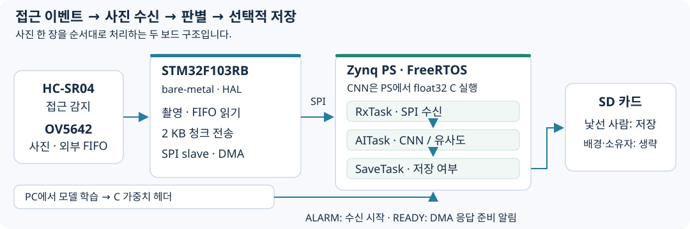

# 접근할 때 촬영하고 필요한 사진만 저장하는 장치

초음파 센서가 접근을 감지하면 사진 한 장을 촬영하고, 배경·소유자·낯선 사람을 판별해 낯선 사람으로 판단한 사진만 SD 카드에 저장하는 시제품입니다. STM32의 센서·카메라 제어와 Zynq PS의 수신·판별·저장을 이벤트 흐름으로 연결했습니다.

**STM32F103RB · Zybo Z7-20 · C/HAL · FreeRTOS · SPI/DMA · CNN · FatFs**

## 시연

[전체 시연영상](media/demo.mp4) · [확인할 구간](docs/demo.md)

접근 알림 뒤 수신·판별·저장을 거쳐 다음 이벤트를 기다리는 흐름을 볼 수 있습니다. 최종 부록 설정과 영상·로그의 중간 버전 차이는 [코드 안내](docs/code-map.md)에 정리했습니다.

## 전체 흐름

STM32는 HAL 기반 bare-metal 펌웨어, Zynq PS는 기존 Xilinx BSP 위의 FreeRTOS 애플리케이션입니다. CNN은 PC에서 학습하고 PS에서 float32 C 코드로 실행합니다. PL에서 AI 연산을 가속하는 구조는 아닙니다.

## 주요 구현

**1. RAM보다 큰 사진을 청크로 전달**

카메라 외부 FIFO에 사진을 보관하고 2,048바이트씩 읽습니다. 최종 보고서 부록의 사진은 320×240 RGB565, 총 153,600바이트로 75청크입니다. 명령과 응답을 분리하고 DMA 등록 성공 뒤 READY를 올려 SPI 응답 준비 시점을 알립니다.

**2. 태스크 사이의 실행 순서와 버퍼 관리**

ALARM ISR→binary semaphore→RxTask→frame queue→AITask→result queue→SaveTask로 연결합니다. 사진 본문 대신 버퍼 포인터를 전달하고, 처리 중 새 접근을 gBusy로 억제합니다. 단일 버퍼 정책이므로 처리 중 이벤트는 놓칠 수 있습니다.

**3. 판별 결과에 따른 선택적 저장**

배경 확률과 32차원 embedding의 소유자 template 유사도를 사용합니다. 낯선 사람으로 판단한 사진만 원본 RGB565 .bin으로 저장하고, 배경·소유자는 저장을 생략합니다.

## 결과와 확인 범위

보고서 로그에 수신·판별·저장 및 저장 생략 분기가 기록되어 있습니다. **93.33%는 PC의 3클래스 validation 60장 결과**이며, 최종 유사도 기반 장치 판별의 정확도와 구분합니다. 전력 수치는 데이터시트 계산·Vivado 추정입니다.

통합 흐름은 보고서 부록에서 복원한 참조 코드로 제공합니다. 보관 시험 코드와 최종 부록의 GPIO·DMA·BSP 설정 차이, 재구성이 필요한 항목은 [재현 안내](docs/reproduction.md)에 명시했습니다.

## 문서와 코드

| 살펴볼 내용 | 링크 |
|---|---|
| SPI 준비 조건·태스크·판별 분기 | [시스템 구조](docs/architecture.md) |
| 설계 선택과 문제 해결 | [개발 과정](docs/development.md) |
| 모델 검증·전력 분석 조건 | [결과](docs/results.md) |
| 보관 소스·보고서 부록의 버전 관계 | [코드 안내](docs/code-map.md) |
| 빌드 설정·재구성 범위 | [재현 안내](docs/reproduction.md) |
| 센서·촬영·청크 전송 | [STM32 통합 참조 코드](source/report-reference/stm32_main.c) |
| 수신·판별·저장 | [Zynq 통합 참조 코드](source/report-reference/zynq_main.c) |
| 모델 구조·C 파라미터 | [학습 코드](source/model/train_cnn_3class.py) · [가중치](source/model/tinycnn3_weights.h) |

---

[대표 프로젝트 모아보기](https://github.com/jounget5411-lab/portfolio)
